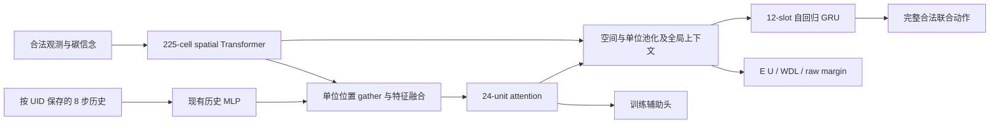

# CarbonFormer：面向 Carbon League 的 Transformer 与 KataGo 式训练方案

设计日期：2026-11-12 UTC / 2026-11-13 北京时间。状态：**可实施的研究设计，尚未实现、训练或部署**。

本方案结合游戏公开规则、仓库代码与三轮审查、用户提供的[围棋 AI 十年史](https://read19.com/guides/go-ai-sota-history)，并核对 KataGo 论文、方法说明和 2026 年空间 Transformer 研究。用户提供的“天梯前三主要采用 KataGo 思路且明显领先”是路线优先级的重要实战依据；尚未获得其私有训练配置，因此不据此断言前三采用相同架构、搜索量或损失函数。

代码详查基线为 `14d53320b20d58bdb82676f7fa866b8e11a55062`；发布前增量核对的 main 为 `09c8724`。原复核证据见 [第三轮 review](REVIEW_FIXES_20261113.md)。本文中的新模块、配置与阶段预算均为提案，不表示已有对应实现。配套文件：[配置示例](designs/carbonformer_v1.example.json)、[来源记录](designs/carbonformer_design_sources_20261113.json)、[公式核算](designs/carbonformer_design_math_20261113.json)、[前置修复复测](designs/carbonformer_prerequisite_checks_20261113.json)。

## 1. 核心决策

**优先把神经网络做强：以真正的空间 Transformer 为主要新架构候选，用 KataGo 式自我对弈、价值学习、多任务监督和策略改进蒸馏持续提升裸网；上线默认直接由网络决策。**

训练时的搜索承担教师角色：在少量局面上花更多计算，给出比当前策略更好的完整联合动作分布，再把改进学进网络。上线时能否少算甚至不搜索，是这条路线需要交付的实际价值。教师的质量、成本与蒸馏后的裸网增益都必须单独检验。

具体决策如下：

1. **主路线：KataGo 式策略迭代。** 冻结一代网络与对手池 → 快速/高预算混合自博 → 完整终局标签与高质量策略软目标 → 训练下一代 → 以裸网对战决定晋级。
2. **主架构候选：CarbonFormer-T1。** 用 225 个格子 token 的 Transformer 替换空间 CNN；保留已经有用的单位协同与自回归联合动作接口。现有 CNet2 是冻结参照和同条件训练对照。
3. **主价值：平台单局拟合得分的条件期望 E[U]。** 胜负和原始分差是辅助目标；旧 `tanh(margin/3000)` 不再被当作真实均值。
4. **默认部署：裸网。** 用最终单文件包在 1.5 核 CPU 的相同墙钟约束下验收。线上搜索是之后独立验证的增量，不能掩盖裸网没有进步。
5. **PPO：同起点、同总预算对照。** 保留其价值；本方案不把沿用旧 reward 的 PPO 当作主线，也不以无限教师算力证明蒸馏“更省”。

可证伪的核心假设是：**固定可靠规则与总预算后，T1 与高质量策略迭代能够比现有架构/训练方式更快地产生强裸网。** 若未见改进，应定位目标、数据、教师、架构或部署误差，不将“Transformer”“KataGo”视为有效性的证明。

## 2. 从文章与 KataGo 借鉴什么

文章梳理了从监督预训练、自我对弈到 KataGo 效率改进、空间 Transformer 的演进。对本项目最有用的不是某个历史 Elo 数字，而是网络、训练数据、搜索与计算后端必须一起比较，以及“模仿对手/人类动作”和“提高自身比赛效用”是不同目标。

| 借鉴点 | 在 Carbon League 中的落实 | 不能直接照搬的部分 |
|---|---|---|
| 自博策略迭代 | 通过强教师改进动作，再蒸馏回裸网 | 不假设有限候选教师一定优于当前策略 |
| 价值与辅助监督 | E[U] 主头，WDL/raw margin 与死亡、入库等辅助 | 树数量不等于围棋 ownership，也不等于终局收益 |
| 不同搜索预算 | 多数快速帧、少数高预算教师帧 | 不直接移植围棋的 visits 数或快慢比例 |
| 搜索探索与训练目标分离 | 记录探索动作、训练软目标和行为温度 | 强制探索访问数不能原样解释为最优策略概率 |
| 全局空间通信 | 225-cell Transformer 建模远处资源、回库与竞争 | 围棋 GPU 上的等时间收益不保证 1.5 核 CPU 上成立 |
| 持续生成新数据 | 当前模型、历史快照、外部强对手的冻结混合 | 只反复拟合同一份榜单回放不是闭环改进 |
| 公平实验 | 同对手池、同墙钟、记录全部数据生成与训练成本 | 不跨池相减 Elo，不用等 visits 替代等计算成本 |

本方案是 **KataGo 思想在同时行动、部分可见、多单位经济游戏中的改编**，不是把围棋 MCTS 改个动作枚举器。首版教师选择可审计的完整联合候选评估；多层 MCTS 只有在它能提高单位成本的标签质量时再引入。

## 3. 游戏契约与真正的优化目标

### 3.1 信息结构与动作

地图为 15×15 环面。每侧最多 10 个工人、2 个基地；工人 5 种动作，基地 3 种动作，单侧完整动作空间上界为 `5^10 × 3^2 = 87,890,625`。不能枚举全部动作，也不能把多单位决策当成相互独立的分类。

双方在同一步同时决定完整动作：

`S[t+1] = F(S[t], A0[t], A1[t])`。

执行策略只能读取该侧合法信息状态 `I[t]`：当前观测、截至当前的观测/动作历史、由这些信息更新的信念。部分地块碳不可见；观测中的零不能单独区分“真实零”和“未知”。采集员看到所在格，种植员看到四邻格，需从己方单位位置重建可见性。对手内部历史与记忆也不能假装已知。

环面移动、先招募后移动/碰撞、低携碳采集员的碰撞规则、树的出生/寿命/抢占、双方基地入库差异，均复用已对拍的精确模拟器。没有主动卖树或砍树变现的动作。终局携碳未入库不自动计分；“终局树少了”不是独立的强度指标。

### 3.2 终局结果必须统一

训练、搜索、回放、评测共同调用一份版本化的 `GameResult` 契约，包含 `terminal_step / reason / official_rewards / previous_rewards / post_cash / validity`。

- 正常满时：使用官方终局 reward；默认最后一次代理观测为 step 298，终态为 299，共 299 次转移。
- 灭绝：沿用原环境的特殊负 reward；幸存方保留前态 reward，不能简单使用本步转移后的现金。双方同时灭绝也不能按现金差臆造胜负。
- 执行异常：由平台裁判结果确定，不由物理模拟器凭空生成。
- 截断：不等于正常终局。没有完整终局标签时，首版主价值损失必须 mask；bootstrap 估计另存字段。

一个已产生的终局结果不可在不同模块中重新解释。源码依据包括 `fastsim.py`、原环境 `carbon.py`，以及本轮已修正的 eval/search 结算。本文不重写另一套近似游戏规则。

### 3.3 平台单局得分 U

本轮实际读取的 [117 首页](https://117.72.210.134/) 公开说明：正常比赛用于 Bradley–Terry 拟合的单局分数为

`U = 0.5 × W + 0.5 × sigmoid(M / 1000)`，

其中 `W∈{0, 0.5, 1}` 分别为负、平、胜，`M = reward_self − reward_opp` 为官方最终分差。单方超时、执行错误或非法动作时仅使用 W；双方异常、平台故障等不计分结果应按裁判状态排除，不能补成普通平局。

这是公开规则的核对，未读取私有评分服务实现；异常字段映射仍需用真实比赛记录对齐。统一实现 `utility_bt_mix_v1`，将规则版本与来源 hash 写进数据、权重和报告。

**主网络直接预测 E[U | I, 续弈分布]。** 不以平均原始分差代替它，也不计算 `sigmoid(E[M]/1000)` 来近似 `E[sigmoid(M/1000)]`。

| 假设结果分布 | E[M] | E[U] |
|---|---:|---:|
| 确定赢 100 | 100 | 0.762490 |
| 一半赢 6000，一半输 4000 | 1000 | 0.503878 |

第二种策略平均分差更高，但平台单局效用更差；这解释了为什么“把价值头改成更大分差范围”仍不足以对齐目标。这里的示例只是数学反例，不是已测策略表现。

对同一有效正常结果，双方标签满足 `U0+U1=1`、`M0=−M1`。但双方看到的信息不同，**不要求 `v(I0)+v(I1)=1`**；它们是对不同信息集的条件预测。

固定对手分布下提高 E[U] 是与公开规则一致的单局目标，不保证未来整个天梯 rating 或名次一定提高。最终同时报告 U、胜平负、分差、异常率和不同对手族结果。

## 4. 现有基础与改动边界

| 当前实现 | 已存在的能力 | 本方案如何使用 |
|---|---|---|
| `cnet2_feat.py` | 33 个棋盘通道、20 个全局量、可见性/信念、24 个单位 token | T1 第一轮保持输入与单位排序，隔离架构变量 |
| `cnet2_model.py` | circular CNN、可选 CellAttn、单位 attention、全局池化 | B0 冻结；B1 同结构重训；T1 替换空间骨干 |
| 单位历史 | 每 UID 8 步历史，当前经 89 维输入 MLP 编码 | 保留语义；temporal attention 后续单项实验 |
| 联合策略 | 12-slot GRU 自回归，前缀跟踪现金、名额、目的地 | 保留联合解码器，新增完整联合软目标训练 |
| 价值 | 旧 tanh 价值与碳图辅助 | 新增命名明确的 utility/raw-margin/WDL 输出 |
| `cnet2_train.py` | 死亡、入库、短期身家等辅助头及 sidecar | 校验标签和 mask 后复用，不当成从零新增 |
| 训练/导出 | Torch、NumPy、rollout adapter、单文件 pack | 新架构必须覆盖整条链，不能只交付 Torch 模型 |

旧 `BC_EXIT_W` 对搜索改动单位的硬标签学习，不等于完整联合策略蒸馏。现有搜索局部记录也不能直接拼成完整 joint-action 访问分布。

## 5. CarbonFormer 的网络设计

### 5.1 结构与候选



**B0：冻结现有合格冠军。** 冻结权重、配置、特征、guard、导出包 hash 与对战结果，不能拿随时变化的 main 网络当基准。

**B1：同架构训练对照。** 与 T1 使用相同数据、目标、训练日程和可比总预算，用来分离“训练方法更好”与“Transformer 更好”。

**T1：真正的空间 Transformer。** 每格一个 token，33 通道逐格线性投影；pre-norm attention + FFN，4 个头，FFN expansion=2；输出适配回旧 `C`，保留单位 gather、ctx 和 GRU 接口。

先实现 **S 档：宽 96、2 层**，测量实际包；若容量诊断和 CPU 余量支持，再预注册 **M 档：宽 128、4 层**。这两个规格是起点，不是已经验证的最优参数。单个 3×3 circular 输入 stem 可作为独立消融，首版不混入。

空间相对位置使用环面偏置：

`attention_score(i,j,h) += bias[h, (xj−xi) mod 15, (yj−yi) mod 15]`。

这样跨地图边界的邻格仍有相同几何关系。不直接复制围棋研究中的非周期 learned RoPE。若后续尝试 RoPE，应采用周期频率或验证过的环面表示。未知碳格仍是有效 token，靠可见性与观测龄表达不确定性，不能当 padding 删除。

225²=50,625 是每头的 attention 分数数目，不是耗时估计。完整模型还包含单位层、GRU、适配器和价值头；参数量、峰值内存和延迟必须在实例化与最终包上统计，本文不承诺某个未经测量的“几百万参数/几十毫秒”。

### 5.2 迁移与其他候选

新空间骨干不能直接加载旧 CNN 权重。采用冻结 B0 的合法观测与完整联合动作蒸馏热启动；可复用形状和语义一致的单位/GRU 参数，但新骨干仍需训练，不能宣称装载后等价。先训练新头/适配器，再解冻骨干与下游，具体解冻点由开发集确定。

以下模块逐项实验，不在 T1 首次训练一起开启：

- **H1，历史 attention：** 每 UID 的 8 步历史独立编码，宽 32/64，残差投影零初始化。出生、死亡、缺失历史有明确 mask；不能按会排序变化的 slot 串接跨步记忆。首版不做跨步 KV cache。
- **X1，单位读图：** 24 个单位 query 对 225 格 key/value 做一层 cross-attention，加入环面位移偏置。已有单位 self-attention 不变。
- **O1，对手行为辅助：** 预测对手下一步动作或短期事件，只读取我方当时合法信息。位置变化不能唯一反推动作时 mask；对手实际同一步动作不能提前输入策略。
- **S1，混合回退：** 现有 CNN + CellAttn 是有意义的竞争者，已有插层与 NumPy 路径。若它在目标 CPU 上更强，就保留它；不预设纯 Transformer 必胜。

训练增强只使用验证过的合法对称变换，地图、动作、历史位移、玩家视角和 UID-slot 映射一起变换。不同平移/旋转对策略是否等价，应先由规则与 roundtrip 测试确认。

### 5.3 价值与辅助目标

首版三类输出明确分开：

| 输出 | 形式与标签 | 目的 |
|---|---|---|
| `utility_bare / utility_mixed` | 两个 sigmoid；分别使用对应续弈的真实终局 U；平方损失 | bare 用于教师叶；mixed 用于混合自博辅助价值学习，见 §7.3 |
| `wdl_logits` | 3 类 logits；交叉熵 | 学习胜负边界及概率校准 |
| `margin_mean_scaled` | 无界线性；M/1000；未裁剪平方损失 | 保留原始分差均值的辅助信号 |

U 本来有界，sigmoid 输出与真实目标一致。raw margin 头则不能用 tanh、裁剪 return 或溢出桶中心冒充真实均值；使用 Huber 时也不能继续声称其最优解就是条件均值。梯度裁剪可以用于数值稳定，但不是裁掉标签尾部。

先复用一组已有死亡/入库辅助，按 UID 定义事件。自然终局不意味着所有存活单位死亡；没有足够未来窗口时记录 horizon mask。异常局没有有意义的正常分差时 mask 掉 margin 项。对手行为和碳图辅助分别消融，不一次堆满全部头。

起始损失示例：`L = L_joint + 1.0 L_U + 0.2 L_WDL + 0.05 L_margin + 0.1 L_aux`。U 两个头按来源分别 mask、归一；同时有两种数据时，`L_U=0.5 L_U,bare+0.5 L_U,mixed`。只做 bare 头校准时仅优化其损失。其他项按有效样本/单位归一，margin 标签已除以 1000；系数只作最多两个开发配置的起点，必须观察各项梯度量级。辅助损失下降不等于比赛变强。

首版不做 83 桶价值分布。若需尾部诊断，再增加有明确阈值的风险预测或含溢出桶的分布头；它们不替换直接 E[U]，也不暗中把目标改成 `E[U]−λ risk`。

## 6. 完整联合动作蒸馏

策略按当前有效 slots 的固定顺序分解：

`log πθ(a | I) = Σ_s log πθ(a_s | I, a_<s)`。

教师提供完整动作 `a^(k)` 及归一化权重 `q_k`，策略损失为：

`L_joint = −Σ_k q_k Σ_s log πθ(a_s^(k) | I, a_<s^(k))`。

对每个候选重放其自己的前缀：GRU hidden、上一个动作 embedding、剩余现金、招募名额与目的地特征都必须一致更新。同根局面可共享 trunk encoding；不同前缀不能错误共享 GRU 状态。

例如教师只允许 `(UP, NONE)` 与 `(NONE, UP)`，独立平均单位标签会额外产生 `(UP, UP)`，破坏协作。完整联合 CE 保留这种依赖。

**不把模型在有限候选集合上的概率重新 softmax 当作主蒸馏损失。** 那只约束候选间相对排序，不能约束完整动作空间的概率质量。可枚举 K 个完整动作，也可从 q 抽 1–4 个完整动作来无偏估计 CE；后者对“这个有限 q”无偏，不表示 q 已覆盖全动作空间。

网络教师热启动时，从冻结教师的完整联合分布采样，硬 CE 是该分布交叉熵的无偏估计。有限 top-k 重新归一后须标为截断分布，不能称原教师完整分布。

保留实际行为的温度、role、合法 mask、decoder/prefix 版本和 guard。若解码后 guard 改动作，原网络 logp 不是最终执行动作的行为概率：需把可解释约束并入解码，或明确记录变换；无法求最终行为概率的记录不能进入要求 importance ratio 的 PPO。

## 7. 主训练循环：把教师的改进学进裸网

### 7.1 按代冻结，区分三种策略

一代 g 固定网络、价值、特征、规则、对手池、教师预算和探索配置：

- `π_g`：裸网，最终希望持续提高的对象。
- `q_g^full`：高预算教师的训练软目标。
- `b_g`：实际自博行为策略，决定产生哪些局面与终局结果。

每个受训练方决策独立采样 `C_t ~ Bernoulli(p_full)`。初始 `p_full=1/8`：fast 帧直接用冻结裸网采样；full 帧计算教师软目标，再按明确记录的行为温度采样完整动作。双方均为学习策略时分别记录模式；固定外部对手不强行套用此比例。

`b_g(a|I) = (1−p_full) π_g^fast(a|I) + p_full q_g^full,behavior(a|I)`。

训练 q 与行为温度变换后的 q 分开保存。按选中模式计算的 logp 是**条件模式概率**，不自动等于边际混合 b_g 的概率；fast 帧没运行教师时不能凭空补出后者。因此此数据用于监督策略迭代，不能直接套入“裸网 PPO ratio”。

### 7.2 生成、训练与晋级

```text
冻结 champion_g、规则/特征和 opponent_manifest_g
采集 pure 完整局与必要分支；冻结 actor/trunk，只校准 utility_bare
通过独立校准门后，冻结 bare 价值头与整代教师配置
对每个新 game seed 与随机席位：
    完整运行至真实终局
    fast 帧：网络动作；保存合法历史与行为契约
    full 帧：教师计算完整 joint targets；保存目标与实际行为
    统一 GameResult → U / WDL / M / validity
验证并原子发布 READY dataset manifest
训练 student_(g+1)：full 帧 joint CE + 当前终局 U + 辅助目标
在开发集选择一次候选；独立确认集用最终裸网包对战
通过健康、资源和配对 ΔU 门槛才晋级；否则保留 champion_g
```

第一轮对手混合起点可为 50% 当前冻结自博、25% 已验证历史快照、25% 固定外部强策略。此比例是待验证配置，不是 KataGo 原参数。外部策略不可用时，停止或显式改 manifest，不能静默退化为全 SELF。历史快照防遗忘，外部策略提供异质性；无需一开始引入复杂 PFSP。

政策小批量初始采用 75% 合格教师软目标、25% 旧高质量 BC 锚点。BC 是稳定正则，不是永久上限；首轮不叠加另一套 reference KL。后续单独比较减弱/移除锚点。价值主要用最近一至两代，均匀按局抽样，再按阶段抽状态，避免长局和 SELF 两视角自动获得过大权重。

fast 帧也能提供真实终局价值与辅助标签，但没有教师改进目标，不能把它的旧行为动作冒充新的策略改进标签。这一点是本项目对 KataGo 思想的改编。

### 7.3 最容易混淆的续弈分布

混合自博的真实终局标签对应 **后续 b_g 与对手混合**，既不是“后续全搜索”的价值，也不是裸网 π_g 的无偏价值。数据记录 `continuation_id`，价值校准按来源与代次分层，不把多代数据混成一个声称精确的当前策略价值。

**首版教师统一采用固定裸网续弈。** 根候选之后，短程 rollout 仅调用冻结裸网与约定的冻结对手策略，绝不递归调用搜索教师；叶节点只读 `utility_bare`。裸网续弈可以按指定温度采样，温度、guard、对手分布都属于契约，不自动等同上线 greedy。

**两个 utility 输出分别路由标签。** `utility_bare` 只学匹配的纯裸网续弈真实结果；`utility_mixed` 学 b_g 的真实结果，作为共享表征与混合行为的辅助价值学习。教师不得读 mixed 头冒充 bare 叶值。辅助 WDL/margin 首版按其指定的 mixed 数据来源训练，只作辅助，不用于重构 bare U；报告不能混称同一续弈下的多头一致预测。

**每代先校准，再冻结教师。** 冻结 π_g 后采集一份纯裸网完整局，在 actor 与共享 trunk 冻结的情况下仅更新 bare 头。通过分阶段、分对手族的独立校准和教师质量检查，才冻结它产生正式标签。训练 π_(g+1) 会改变表征与行为，旧 bare 头只作初始化，下一代必须重新校准。首次 pure 数据收集可从 128 局开始；局数是预算起点，不是足够校准的保证，全部计入成本。

纯初始局可能覆盖不到 mixed 自博和反事实候选产生的困难叶。需要时从这些状态恢复完整合法历史，另开分支，强制按匹配裸网续弈至真实终局生成 bare 标签；分支继承原 lineage，旧 mixed return 不能复制为 bare 标签。冻结生产教师后新发现的覆盖缺口进入下一批校准，不一边改教师一边宣称整代固定。

预算用尽仍校准不合格时停止本代或简化教师；不能靠更多 mixed 标签弥补 bare 标签语义。bare 和 mixed 的价值差用于监测分布偏移，最终仍以实际上线温度/guard 的裸网对战验收。对手私有身份不得成为线上依赖。

离线重搜旧回放只更新策略 q；旧 observed return 仍来自旧续弈。若要新策略的价值标签，必须真实继续对局，保存派生 lineage；不能改个 q 就把旧结果标成新策略价值。

### 7.4 教师强于学生不等于学生会变强

每代同时记录三种结果：裸网 π_g、教师策略、蒸馏后的裸网 π_(g+1)。教师赢得更多而学生不提高，可能是目标覆盖、容量、标签噪声、优化或教师/部署分布差异，不能只报 search-on 总分作为成功。

历史强策略回放用于热启动与覆盖困难局面。只提高 BC 准确率有模仿上限；自博策略改进负责产生超出旧行为的新目标。对手动作辅助服务于表示学习，不等同于让己方模仿对手所有动作。

## 8. 训练教师：先保证标签质量，再增加搜索复杂度

### 8.1 完整根候选与共同场景

首版从完整合法动作开始：裸网 greedy、若干自回归采样、少量强制关键前缀后重新解码的动作，去重得到集合 A。起始上限 `K=16`。候选必须包含整侧工人和基地，不能只评估一个 collector 的动作却忽略其余同时动作。

对每个根局面，从合法历史构造隐藏碳与对手私有信息的场景，采样 `M_scenario=8` 份。**根对手动作在查看己方候选前生成**，各候选共享这批根场景与随机数，以减少比较噪声。对手动作与其隐藏信息之间的相关性必须保留；不能先独立抽动作再拼到不兼容的隐藏地图上。

初版信念优先复用当前合法观测、观测龄与经过验证的更新规则；未知格仍保留不确定性。不能从 full replay map 取得真实隐藏碳再宣称是可在线获得的教师增益。可另做带 oracle 标记的上界诊断，但不得混入正式教师质量结果。

对手私有历史不能用我方历史简单翻转代替。先使用有明确条件信息的对手模型/策略池和一致的历史粒子；不能恢复其记忆时显式采用无记忆近似并测误差。这是模型风险，不是已知事实。

每个候选推进初始 `H=2` 个双方同时动作的精确转移（包含根候选执行的第一次转移），再读 E[U] 叶值。后续步可共享随机流，但动作必须根据各分支各自的信息重新计算；不同分支不能盲目复用同一对手动作。真实终局直接用精确 U，不调用价值网络。

### 8.2 从 Q 到训练软目标

候选价值是共同场景下的均值 `Q_k = mean_j U_hat(k,j)`。它有信念、对手模型与价值近似误差；Monte Carlo 标准误只反映抽样部分，不能当作总误差。

首版采用固定且平衡的候选评估预算，先避免不均匀访问/自适应停止带来的额外偏差。教师软目标可取：

`q_k ∝ P_A(k)^α × exp((Q_k−max_l Q_l)/τ_Q)`，

其中 `P_A(k)=π_g(a_k|I)/Σ_l π_g(a_l|I)` 只是教师候选先验，所有概率用完整联合 logp 的 log-sum-exp 稳定计算。初始 `α=0.5, τ_Q=0.05`，按 U 的 [0,1] 标度定义，在开发集最多比较两档。训练学生时仍使用 §6 的完整联合 CE，不在学生侧做候选集合归一。

这是**有限候选价值软改进目标**，不是 MCTS 访问分布，也没有覆盖完整动作空间或必然改进的保证。保存原始 Q、场景数、先验、候选生成概率可得部分、q、行为温度与目标版本。

若之后引入 PUCT/forced playout，应完整记录原始访问数和去除强制探索后的目标访问数；局部 slot 的访问数不能拼成 root joint visits。是否采用多层 MCTS，看它在同生成预算下能否产生更好的可蒸馏目标，而不是仅看更深。

### 8.3 同时行动与信息集边界

不能采用“己方先选动作，敌方看见后再选最坏回应”的轮流博弈树，那给了敌方不存在的信息。针对固定对手模型的搜索应边缘化其同时动作分布；若研究抗剥削策略，可另建立有限候选 payoff 矩阵求混合解，但不能把它称为原游戏的 Nash 解。

根时对隐藏状态做场景平均；分支里的后续动作仍只读该分支该侧合法观测历史，不能读场景真实隐藏图。完整状态用于环境转移，和策略可以知道什么，是两个接口。

### 8.4 教师必须先通过质量闸门

从预先冻结的开发局面抽样，比较教师与裸网动作。候选选择使用一组粒子/RNG；质量验证使用**独立场景与随机数**，一部分局面从真实合法前缀继续到完整终局，按根局面成组统计 ΔU。不能在同一批叶估计中挑最好候选，再把其估计提升当真实收益。

至少分开检查早中晚期、招募/基地拥堵、碰撞、回库、树生命周期、灭绝边界、低可见性和异常对手。若教师只在自己的价值头上“变好”，真实 continuation 不提高，则不生产大规模正式策略标签。

C01 的教训写成永久契约：**已精确终局的候选不受最小启发式展开深度限制**。全部终局就直接比较；混合终局/非终局和预算中断也要保留各自状态，不能一概回退默认动作。

分支 clone 必须包含 reward 前态、步数、配置、UID、双方历史、信念、角色、RNG、prefix 与缓存。缓存 key 包括全部影响编码/价值的字段和权重版本；同一地图坐标不代表同一信息状态。

### 8.5 预算算清楚

示例 `K=16, M_scenario=8, H=2`，每个 full 帧最多有 128 个叶场景、256 次双方联合转移，提前终局会减少它们。fast 帧额外搜索为 0，`p_full=1/8` 时每个受训练方决策平均约 16 个额外叶场景、32 次模拟联合转移。

这些数字不含候选生成、对手网络、历史/信念构建和批处理开销，也不是等同于 128 次独立网络 forward。有效非终局叶可以批处理。每侧最多 299 个决策，full 帧期望约 37.375；双方都运行教师时成本需分别相加。任何 endgame 加量策略都要另计。

先测教师每状态成本与每小时产生的合格目标数，再决定总体硬件预算。不能从理论节点数推出每天局数，更不能先承诺冲榜时间。

## 9. PPO 对照与奖励设计

PPO 对照使用相同起点、同一冻结对手分布、新种子和独立的纯网络行为采样；比较总环境生成、教师推理、优化器训练的设备小时，而不只比较梯度步数。

第一版以真实终局 U 为唯一奖励，`gamma=1`，critic 学同一 return；不用旧现金/身家增量再加额外 win bonus，也不沿用 `ret.clamp(-1,1)` 来迁就旧 tanh。若统一改为 `Z=2U−1`，reward、critic、SELF 标签、搜索与报告都必须显式转换。

完整联合动作计算 `rho=exp(logπ_new(a|I)−logπ_behavior(a|I))`，再使用标准 PPO clipped surrogate。各 role 的温度与 mask 必须匹配采样当时。GAE 的 λ 是估计器参数；λ<1 与近似 critic 会引入偏差，不能宣称无偏。按单位数与阶段记录 KL/clip fraction，防止总体均值隐藏大联合动作的方差问题。

若使用 reference KL，按参考策略采样完整前缀估计联合 KL；仅在 replay 前缀算条件 KL，要如实称局部前缀正则。主蒸馏路线首版已有 BC 锚，不默认再叠加此项。

潜势塑形可以作为后续独立实验：`r'_t=r_t+Φ(I[t+1])−Φ(I[t])`，终局 Φ=0、函数与尺度冻结，得到 `G'_t=U−Φ(I[t])`。若严格参数化 `V'=V_U−Φ`，TD residual 与 GAE 与原式相同；它是正确性不变量，**不能承诺自动加速**。独立拟合 shaped critic 的优化收益需实测。若改 `gamma<1`，目标已经折扣化，不再精确等于公开终局 U。

## 10. 数据契约与失败处理

### 10.1 三层数据对象

| 对象 | 必须记录的字段 |
|---|---|
| Episode | game_id、origin_lineage_id、规则/utility 版本、map seed、双方权重与角色、对手池、席位、完整步数、结束原因、官方 reward、U/WDL/M 与各标签 mask |
| Decision | game/step/player、合法观测与可重放历史或其引用、feature hash、UID-slot 映射、完整动作、实际温度、条件模式 logp、fast/full 模式、guard 结果、continuation_id、抽样概率 |
| Teacher target | root 信息 hash、完整候选、Q 与场景数、q、目标/行为温度、教师权重、候选与信念版本、RNG、是否 oracle、质量状态、终局精确值与估计值分开 |
| Dataset manifest | schema_version、来源快照、split 规则、成功/失败/合法零行局 ID、行数/局数、数组校验和、训练与评测 lineage 清单、READY 状态 |

从原始回放生成的镜像、重标注、分支恢复、重试与同局不同视角都继承根 `origin_lineage_id`。改文件名、改 teacher 或重新搜索不产生独立样本身份。采样/增强 lineage 必须先决定 split，再生成派生数据。

没有真实教师目标的 fast 行，teacher 字段为 null/显式无效；不能补均匀 q 或伪造 logp。真正完整终局标签与 truncated bootstrap 分开；短期事件的 horizon mask 独立于主终局 mask。

### 10.2 发布时失败关闭

正式 builder 在任何读取、解析、标签或 hash 错误时非零退出，不发布 READY。先写临时目录，全部验证成功后原子发布。`allow_partial` 只能是显式诊断模式，保存缺失局及原因，默认训练入口拒收。

训练入口同时核对 manifest 状态、有效局数、各局行数、成功列表与原始 index、数组 shape/finite、各类标签 mask、split lineage 交集、feature/utility 版本。仅比较 `len(meta.games)==len(index)` 不够；合法零行必须有可审计原因，不能与失败局混淆。

缓存以真实源 hash 和完整构建配置定位；失败 shard 不认证。重新标注有新版本，保留原始 return 与行为事实。稀有失败过采样要保存选择概率；主均值回归采用校正或独立均匀采样，否则学到的是人为重加权分布的均值。

### 10.3 训练输入不能偷看未来

完整回放碳图、未来死亡/入库、对手实际同一步动作可以作有 mask 的监督目标，不能成为 actor 输入。历史还原逐步推进，不从最终 UID 集合逆推当时可见信息。所有数据至少随机抽局重放到每个决策前，核对部署特征与训练特征。

## 11. 评测：让“网络更强”成为可检验结论

### 11.1 开发、选择与独立确认

- **训练集：** 指定自博/回放来源，按 lineage 分组。
- **开发集：** 调网络、教师、辅助权重、预算与停止点；允许反复使用，但结果不称独立泛化。
- **选择集：** 在预先限定的小候选集中选一个最终候选；一旦用于选择，就不是最终保留集。
- **最终确认集：** 新种子与未参与调参的对手/对手族；候选与阈值冻结后运行一次。失败后若继续调参，需要新的确认集。

若某个外部强对手训练时已出现，不能再把对它的确认结果称未见对手泛化。没有实际 top3 对手可运行时，清楚标注代理对手；只有实际平台对局能验证对这些策略的表现，不凭离线代理承诺排名。

采用相同 map seed、对手与双席位成组比较候选和 B0/B1。一个 seed 下的镜像、多帧、多分支不是独立样本。以 seed/根局面或更高相关层级做配对 cluster bootstrap；跨对手族按预注册权重汇总，报告分层结果。

### 11.2 指标与晋级条件

主指标是最终裸网包的 **配对 ΔU**，同时报告 95% 区间。次指标：胜平负、raw margin、灭绝率、执行异常、分阶段/对手族表现、资源。模型预测指标包括 U MSE/校准、候选排序 regret、WDL 概率评分和 margin 均值校准；它们是诊断，不替代实战。

初始晋级规则：健康与资源门全通过；预注册最终集 ΔU 的 95% 区间下界大于 0；重点对手族没有超出预先设定容忍量的退化。容忍量由业务偏好在开跑前固定，不能看结果后调整。若区间跨 0，则结论是证据不足，保留冠军；不能反复追加到显著为止。

试验阶段 128–512 局是发现流程/大效应的预算，不保证检出小收益。最终样本量先用开发集的成组方差和最小有意义 ΔU 估计并锁定；可从 256/512 局作资源规划，但不能把它们当统计充分性的保证。若要中途查看并停止，预先制定序贯规则；否则固定样本量。

单次训练的对战区间不涵盖训练随机性。选出的有效路线再用至少 3 个独立训练 seed 复验，分别报告成本和增益，避免只发布最好一跑。

### 11.3 必须分开的消融

| 比较 | 回答的问题 |
|---|---|
| B0 vs B1 | 新目标/数据/训练是否让现有架构变强？ |
| B1 vs T1 | 同条件下空间 Transformer 是否有增益？ |
| T1 网络教师热启动 vs 加搜索软目标 | 搜索提供的改进是否能学进裸网？ |
| 同起点蒸馏 vs terminal-U PPO | 相同总预算下哪条训练路线更有效？ |
| T1 vs T1+H1/X1/O1，逐项 | 新历史、读图、对手辅助各贡献多少？ |
| 同一权重裸网 vs 线上搜索 | 额外在线计算的独立收益是多少？ |
| fp32 vs 量化最终包 | 包装模型变化与部署误差的代价是多少？ |

同时报等样本和等训练墙钟；上线比较采用相同平台上限。大网络能在安全预算内获得更多 U 就有价值，不要求为搜索预留大部分时间，也不用有非零基线的 `U/耗时` 比值替代真实取舍。选择 U 与延迟的 Pareto 前沿。

## 12. 部署与资源契约

本轮公开 [agent guide](https://117.72.210.134/static/agent-guide.md) 说明：Python 3.12、NumPy 1.26.4、可选 PyTorch 2.5.1+cpu；单 UTF-8 文件不超过 **10,000,000 字节**；1.5 CPU、512 MiB；初始化 20 秒，包含 import/编译/顶层加载。

每步基准 1 秒且含进程通信；单步最多 3 秒，整局最多 3 次慢步、超额总计 5 秒，快步不返还。1500 秒是整个排位比赛任务上限，不是单个策略每步预算。延迟到 agent 内才加载权重会计入动作时间。

初始内部动作预算设为 **0.80 秒总量**，留通信及系统波动余量；它是待实测的工程目标，不是平台承诺。网络可使用安全预算内的大部分时间，默认 `online_search=false`。

需要建立独立 `arch` 分派：现有 NumPy 路径依赖 CNN 的 `stem.weight/blocks.*`，不能把新 checkpoint 塞进去期待自动兼容。先做 Torch/NumPy fp32 同权重 parity，再测量化。现有 int8 打包是存储压缩后反量化为 fp32，不能据此宣称 int8 计算提速。

部署验证分三层：

1. **数值语义：** 相同输入、权重、prefix 与 role 下，trunk、logits、utility 和完整联合 logp 一致；greedy 与概率 parity 分开，近并列动作记录 top2 gap。容差基于 fp32 基线预先固定。
2. **最终包行为：** 同一反量化权重在 Torch/NumPy/pack 一致；原 fp32→量化是模型变化，另测动作漂移和比赛 U。辅助头只有不参与决策路径时才可剥离。
3. **真实资源：** 受限 cgroup 中测冷启动、首步、稳定步、最大单位/历史、p50/p95/p99/max、整局墙钟与峰值 RSS；包括转置权重副本、attention cache、库与临时激活，不能只报参数大小。

所有验证统一汇总 `errors` 与全部数值型 `*_errors`，保存分类明细和 first_error。fallback 发生仍计错误，不因输出一个合法动作就算成功。0/1 局也保留健康记录，seed 数与请求局数必须一致。游戏 step0 重置历史、信念与角色缓存；同局后续调用保持正确的持久状态。

## 13. 实施顺序、交付与停止条件

### P0：可靠底座与冻结基准

冻结 B0 的真实包、权重、规则、feature 与对手 manifest；统一 GameResult/U、数据 READY 和错误统计。发布前 main 增量确认：**C01、C03 已有针对性修复且原探针通过；C02 构建与开训链未变，仍是前置待办**。bigeval 种子长度与极小样本诊断也有修复。相关轻量复测只验证控制流，不是新平台性能认证。

验收：终局奖励各边界与原环境一致；坏数据不能开训；异常包不能通过计时门；正式数据无 lineage 泄漏。C02 未关闭前不放量训练。

### P1：目标与联合概率先接通

实现 U/raw-margin/WDL、完整 joint CE 与数据契约。用至多 1000 局已有完整回放热启动；若无合格记录，先生成 128 局低成本完整局。旧 replay value 只作热启动，不当当前策略无偏真值。

验收：公式、mask、联合前缀、角色温度与标签抽查通过；U 相对按阶段/对手分层均值基线有可解释改进；新价值头未接决策时不应意外改旧包动作。若失败，先查语义和标签。

### P2：T1 架构与后端

实现 T1-S，完成 teacher 蒸馏热启动与最终包 parity/资源测试；同时保留 B1。只有小档容量/余量证据支持才试 M 档。H1/X1/O1 暂不开。

验收：模型可训练/导出、CPU 包合规；等数据/预算的开发对战能区分容量与实现错误。若 CPU 不合格，先优化或回到 S1，不能用 GPU 推理成绩代替。

### P3：证明教师有用

实现根联合候选教师及独立验证；先固定 K/M/H 与温度，少量完整 continuation 检查。使用新的 E[U] 叶，禁止沿用旧匿名 tanh 值。

验收：在预注册开发局面上，教师改进不只来自复用同一批噪声；成本与合格目标吞吐明确。教师无增益就停止放量，检查 belief、候选覆盖、对手模型和价值校准。

### P4：小预算完成一代闭环

首轮 128 局，最多扩大到 512 局，至多两代、每代一个已锁定配置；full=1/8 起点，政策 75% teacher +25% BC。完整记录纯裸网校准与教师生成的额外成本。只在开发/选择集挑一个最终候选。

验收：裸网对同冻结基准的 ΔU 有增益迹象，且最终包稳定；若 CE 降但裸网不涨，不能以 search-on 成绩过关。PPO 对照使用独立同起点预算。

### P5：独立确认，再决定放量

冻结唯一候选与实际包，按预注册样本量、独立 seeds/对手、双席位跑最终验收；满足 §11 才晋级。之后做多训练 seed 复验，决定扩大模型、生成或数据覆盖哪个瓶颈。线上搜索留作独立实验，不是这条路线的验收必选项。

这些阶段是工程顺序与停止条件，不是训练日程承诺。本轮只提交设计，没有启动训练、部署模型或提交天梯策略。

## 14. 建议模块与接口

下表路径为**建议新增或重构的接口名称**，并非已经存在的文件；可在实施时依仓库风格调整，契约不能隐式改变。

| 建议接口 | 责任与测试重点 |
|---|---|
| `game_contract.py::step_game/result` | 精确转移、previous reward、终局原因；自然/单方/双方灭绝与最后一步 |
| `utility.py::score_result` | 公开 U、异常 mask 与版本；eval/train/search 共用 |
| `carbonformer_model.py / carbonformer_np.py` | T1、arch/meta、环面注意力与后端 parity |
| `joint_targets.py::joint_logprob/loss` | 完整动作、不同前缀、现金/名额、候选 CE 的精确枚举对照 |
| `teacher_root.py::make_targets` | 根同时动作、belief、共同随机数、精确终局、独立验证 |
| `selfplay_generation.py` | 冻结代次、fast/full、role 温度、continuation 与实际行为记录 |
| `dataset_registry.py` | lineage、schema、hash、失败关闭、原子 READY 发布 |
| `paired_eval.py` | 双席位 seed 成组、ΔU、区间、异常与资源统一报告 |
| `export_student.py` | 训练/推理参数分离、量化标记、单文件与受限资源认证 |

需要新增的核心配置键包括 `arch / feature_schema / utility_version / continuation_id / teacher_target_version / opponent_manifest / dataset_manifest / lineage_split / online_search`。配套 JSON 是设计样例，现有 CLI 不保证识别；不能把未知参数静默忽略后声称方案已启用。

## 15. 哪些结论已有依据，哪些仍需实验

| 判断 | 证据状态 |
|---|---|
| 当前公开平台评分与 CPU/文件预算 | 本轮实际读取公开页面，来源与 hash 附后 |
| 现有网络已有单位 attention、历史 MLP、可选 CellAttn 和多项辅助 | 代码核对；不能把它们算作新方案全部收益 |
| 旧目标与平台 U 不同，候选内 softmax 不是完整联合 CE | 可由公式与代码直接判断 |
| KataGo 思想在本梯队具有优先实践依据 | 用户提供 top3 观察；私有实现未独立核验 |
| T1 在本游戏比 CNet2 更强 | 待等预算训练与 CPU 裸网对战验证 |
| 教师生成的软目标能提高裸网 | 待教师独立验证与一代闭环，不由搜索自身胜率推出 |
| 最优 K/M/H、p_full、网络尺寸、训练天数 | 尚未测量；本文只给受限起点 |
| 可以冲到第几名、提高多少 Elo | 现有证据不足，不作承诺 |

核心交付不是一张更复杂的网络图，而是一条可审计的改进链：**合法信息 → 正确效用 → 有增益的教师目标 → 学得进去的联合策略 → 在新对手与真实 CPU 预算下变强的裸网。**

## 16. 参考来源与阅读边界

1. 用户推荐：[从 AlphaGo 到 Transformer KataGo 的围棋 AI SOTA 十年史](https://read19.com/guides/go-ai-sota-history)，文章标注信息截至 2026-08-24。本轮读取全文，借鉴历史路线、整体系统比较和等时间评测，不复制全文。
2. David J. Wu：[Accelerating Self-Play Learning in Go](https://arxiv.org/abs/1902.10565)，2019。重点核对多任务、搜索预算随机化、探索与策略目标；本文快帧价值使用、联合动作和实际参数为本项目改编。
3. KataGo：[KataGoMethods.md](https://github.com/lightvector/KataGo/blob/master/docs/KataGoMethods.md)，方法补充与实现细节；引用 master 的读取内容 hash 留档，后续网页可能变化。
4. KataGo：[v1.17.1 release](https://github.com/lightvector/KataGo/releases/tag/v1.17.1)，Transformer 网络及后端支持；支持某架构不代表其在 Carbon 受限 CPU 上更快。
5. lightvector：[How Symmetric Are the Insides of a Go Network?](https://lightvector.github.io/katagostudies/202607-symmetry/)，2026-07。核对 spatial Transformer、位置表示与等计算/等时间比较；不将该 GPU 条件下的 Elo 外推到本项目。
6. Carbon League：[公开首页](https://117.72.210.134/)、[agent guide](https://117.72.210.134/static/agent-guide.md)、[replay API](https://117.72.210.134/static/replay-api.txt)，2026-11-12 UTC 实际读取。
7. 本仓库：[第三轮修复 review](REVIEW_FIXES_20261113.md) 与对应证据目录。发布前增量修复的状态以本文 §13 的补核为准，旧报告保留其历史审查时点。

本文只对来源作必要概括；源页面快照 hash、公式例子和提案配置可独立核验。未将原文章全文或第三方完整论文复制入库。
