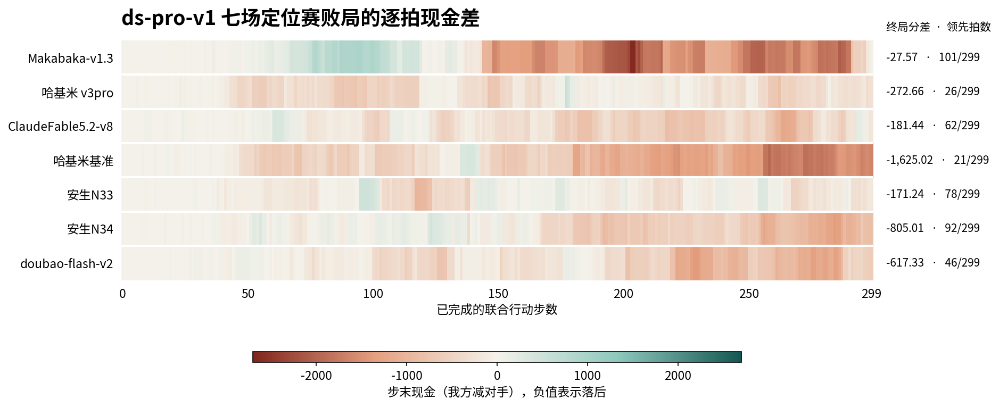

# ds-pro-v1 定位赛七场败局与优化验证

定位赛 33 场中，v1 胜 26 场、负 7 场，胜率 78.79%。席 0 为 14/17，席 1 为 12/16。全部 299 步正常结束。七败合计少 3,700.27 分，树的净经营收入合计约少 3,348.7 分。只看这七场的累计金额，树是最大缺口；落到单局，Makabaka 的树净收入反而领先 565.96，安生 N33 的树净收入只相差 4.92。按同一个原因去修七场会改坏原来赚钱的动作。[截至北京时间 15:21 的全部官方定位赛、比分与经济账](../placement_refresh/README.md)

| 官方败局与分差 | 从开局追到的关键选择 | 已做的核验 |
|---|---|---|
| Makabaka-v1.3，−27.57 | t100 仍领先 889.42。随后两名返程工丢 633.55 和 387.94。t138 第一人还能原地等待；到 t140 第二人的五个落点都在敌方一步可达范围，改路窗口提前到 t135 附近。 | 官规重放第一名工人原地后仍有 642.67。同期胜局中重载工曾 10 次进入同样被轻敌一步覆盖的返航近路，10 次都活到交货。需要估计对手走入该格的概率。[路线与胜局反例](claude_maka.md) |
| 哈基米 v3pro，−272.66 | t36 开始持续落后。我方 16 棵新树只有 9 棵在首次持有期回本，对方 37 棵有 32 棵回本。残局还存在一条原搜索没有提出的队友接力。 | t295 只改 37 号首令，可经两名队友多送 130.58，固定后续实令仍负 142.08。穷举其最后四拍 625 个序列均未翻胜。另一图同席对同一版本赢 1,496.84。[两场完整账与接力复演](hajimi.md) |
| ClaudeFable5.2-v8，−181.44 | t72 起连续落后，t116 有机会提前封回库入口；t254–264 对方到账 919.22，我方 27.08。t296 我方又领先 75.32，最后三拍才定输赢。 | 30 种控制路径中 25 种能延迟历史那笔 340.20 回款，对方尚可改入口或基地。仅改末拍的 20 种单实体命令均未增加官方终分。[开局至末段的行动比较](claude_maka.md) |
| 哈基米基准，−1,625.02 | t50 持树 1 比 8。即使 t138 再度领先，最后约一百拍树净收入仍是 40.52 对约 1,246.46。全局交货比对方多 370.76，树净少 1,845.79。 | 新护树模型在 t30 对格 200 给出 0.78 的五拍失守概率，三拍后易主。同局另有高风险树最终保住。训练应同时保留报对和误报的场景。[两侧种植、夺树和返款](hajimi.md) · [新模型](tree_defense/README.md) |
| 安生N33，−171.24 | t118 我方 16 号距空库一格，载 136.95，绕六拍回到起点且全程未新增采收。t289 我方又领先 110.15，最后十拍对方交货 745.05，我方 463.95。 | 六拍对照中，先交库再回原格多 136.95 现金，工人已新采 72.65。胜局中推迟交仓也有多采 30 的例子。末段对方三工能同拍到账，需把基地落点合并一并评分。[双方 3/5/10 拍轨迹及反例](ansheng.md) |
| 安生N34，−805.01 | 我方投入 30 棵，17 棵首次持有期回本、10 棵回本前被夺。t65 的 17 号在格 95 花 70.97，首次持有期仅收 14.54。t164 起未再追平。 | 固定其他指令，t65 改上、下走，八拍现金各多 64.33、69.26，种植工都存活。普通天梯同版本换席复战，反赢 199.74，树净差改善 849.09。[可走与不可走的备选](ansheng.md) · [复战](../placement_refresh/README.md) |
| doubao-flash-v2，−617.33 | t61 起连续落后，t184 最后领先 2.07 时，持树 1 比 8，在途货 232.85 比 610.18。到 t218–228 对方四笔到账 958.59，我方仅 44.52。 | t215 我方 44 号原地能截对手 277.34；到 t218 同一人追另一名更轻的敌工反会送货。两处均用官方引擎、同拍实际敌令验证。持货尚需兑现。[299 拍官方复演及单工对照](../placement_refresh/README.md) |

图中每一列代表一拍，以同一分差刻度显示我方当时领先或落后多少。表右的领先拍数按 t1–299 的严格正现金差计。[复算程序](lead_chart.py)

## 哪些改动值得再测

**守树。** 新训练的模型预测已持有的树会不会在五拍内被夺。整图留出的 8 张图上，等量检查 490 个警报，按距离和树龄排序找出 149 次易主，加上双方工种、载重和近期移动后找出 203 次。警报仍有 287 条未发生易主，把每条警报直接改成回防会挤占采运。另在四张已曝光图，只改一名种植工，其他己方首令固定，两边随后对新局面应手至官方终局；四个终分变化为 +67.42、−4.21、−188.18、+218.69。可用这些成对动作学习权衡，单棵树赚亏不足以预测整队收益。[失守预测的训练权重与逐图检验](tree_defense/README.md) · [单工真实应手到终局](../../tree_action_outcomes/README.md)

**截货与护货。** doubao 两个相隔三拍的机会表明，同一个单位只因双方载货轻重和目标格变了，主动相撞的收益方向便可翻转。行动前估计对手会去哪格，官方碰撞规则决定货归谁，还要比较幸存者能否返仓。对 Makabaka 的历史胜负图，已有护货头在两张新图对原版 4/4，母包同样 4/4，候选平均官方分差反少 34.33。另一项四选一的对手预测在原版实际修改出令的 294 个局面中只覆盖 21 条真实整队令。继续只微调评分，仍选不到缺席的对手走法。[护货候选整局对照](../cargo_defense/development/README.md) · [真实对手命令覆盖](../../opponent_search_model/README.md)

**搜索比较。** 当某条推演路线有工人阵亡，原版相同种子会让后续幸存工人的随机动作顺序也改变。我方候选按工人身份配对抽样，两张新图对原版 3 胜 1 负、平均 +451.79，同图母包 1 胜 3 负、平均 −279.36。两图的相对改善分别 +27.97 与 +1,434.33，以相同字节另登记四张开发图验证。两张图合计 4,784 个双方外部请求，零慢步、零超时。该成绩只覆盖对应开发地图。[完整单文件及原理](../../identity_crn/README.md) · [八场比分与用时](../../paired_improvement_dev/README.md) · [四图重复检验](../../identity_replication_dev/protocol.json)

**开局。** 席 0 与席 1 的原开局分别偏向双采集、采集加种植。定位赛的席位成绩不能把两种开局的效果分开。在同席同图只替换首拍基地招募后，原版对手完整应手至终局。一图多 155.63 分，另一图少 321.84 分。当前继续保留原开局，两种首令各自产生的真实轨迹可用于训练。[四场开局干预](../../opening_recruitment/README.md)

天梯已上传版本、内部候选及正式考卷分别登记。正式目标仍是冻结后 100 张全新图换席对原版 Master3s2，同一批 200 局至少 180 胜且官方平均分差至少 +500。[派生线总账](../../README.md)

护树模型在两处能实际改令的末段局面已对完整原版续弈。两处分别少 128.47 和 52.64 分，后一处确实保住了树，但我方少回库 72.51。这项实战结果支持保留预测、暂缓部署自动护树。另造的末段队友接力在哈基米原局确实发出新命令，但在其余 32 张定位图和 6 张原版开发图中都未触发；现阶段收益只由该特定局面支持。[护树实战](tree_defense/response/README.md) · [接力候选与负控](relay_search/README.md)

上述按身份配对抽样的四图复验已经打满。候选对原版 3/8、平均 −64.98，v1 父包 5/8、平均 −25.86，因此本次没有把这项改动放进 v3。v3 在 v2 上补充提前拦截候选。[四图完整结算](../../identity_replication_dev/README.md) · [v3 发布资料](../../v3_release/README.md)
