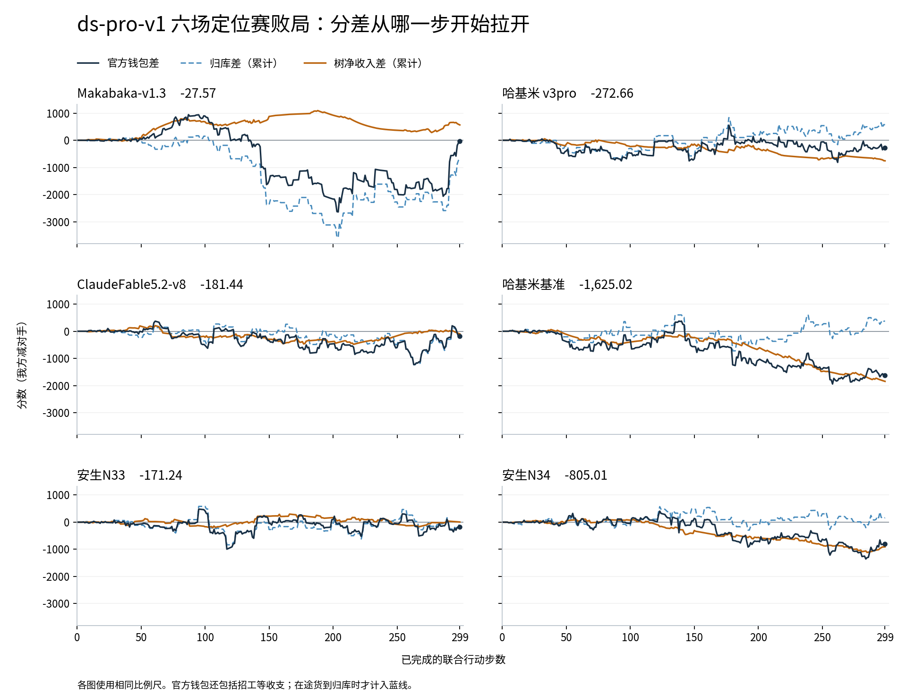

# ds-pro-v1 定位赛全体败局复盘

截至**北京时间 2026-11-20 14:30:19（UTC 06:30:19）**，官方两页共返回 ds-pro-v1 的 **32 场已计分定位赛，26 胜 0 平 6 负，观察胜率 81.25%**。32 张不同地形全部打满 299 拍、双方 DONE。席 0 为 14 胜 2 负，席 1 为 12 胜 4 负。相较上一份 31 场记录，唯一新增是席 1 负安生N34，分差 −805.01。冻结时列出的赛事均已结算。每场的对手注册 ID、座次、比分、用时、地形及回放 SHA 均可逐项复查。[两页官方赛卡快照](snapshot.json) · [32 场索引及 6 场逐拍账](ledger.json.gz)

北京时间 14:47:38 再读两页，场号、官方结果与状态均与已冻结的 32 场一致。[第二次读回](latest_check.json)

全批共遇到 30 个对手注册 ID，32 局平均官方分差 +1,758.36。26 场胜局的分差中位数为 +1,836.42，2 场赢不到 500 分，分别是对 1C-Test 的 +93.26 和对 stephen-K4TacSearch-v6 的 +473.58。对手和地形随定位赛变化，池内的分差不能折算成对某一个强手的胜率。

**三场败局里我方实际回库更多，仍因树净收益差落败。** 哈基米基准一场，回库多 370.76，树净少 1,845.79。另三局中，Makabaka 的两次截货实际变成了对手的钱，安生N33 的末段由对手三工同拍交付左右，Fable v8 则在我方追上后又完成了末段反超。Fable v8 在 t296、安生N33 在 t289 仍由我方领先，回看最后一次转手后钱进了哪一座基地，才能解释最后的差距。

## 六局各自丢在什么地方

下表每项差额从我方看。树净计树收入扣种植和夺树费用，招工列给出双方招工现金流之差。旧复盘个别表项先分别按席取整再做差，两种算法至多相差 0.01。此表各列从逐拍未舍入金额独立求差后保留两位；由此单局相加与官方分差最多差一分。赠款和碰撞直接入钱包在这六场均为零，载货碰撞转移由最后的实际归库计入现金。工号均指对应席的编号。

| 官方对手 | 我席 | 官方分（我 / 敌） | 分差 | 归库差 | 树净差 | 招工差 | 钱包取整差 | 整场秒 |
|---|---:|---:|---:|---:|---:|---:|---:|---:|
| Makabaka-v1.3 | 1 | 10,973.14 / 11,000.71 | −27.57 | −653.49 | +565.96 | +60 | −0.04 | 144.477 |
| 哈基米 v3pro | 1 | 8,220.11 / 8,492.77 | −272.66 | +573.25 | −755.87 | −90 | −0.05 | 318.597 |
| ClaudeFable5.2-v8 | 1 | 6,925.94 / 7,107.38 | −181.44 | −142.86 | −98.59 | +60 | +0.01 | 289.399 |
| 哈基米基准 | 0 | 7,931.73 / 9,556.75 | −1,625.02 | +370.76 | −1,845.79 | −150 | +0.01 | 147.551 |
| 安生N33 | 0 | 7,289.39 / 7,460.63 | −171.24 | −116.02 | +4.92 | −60 | −0.14 | 275.200 |
| 安生N34 | 1 | 6,978.42 / 7,783.43 | −805.01 | +163.07 | −908.10 | −60 | +0.02 | 279.162 |

六场总分差 −3,082.94。按分项汇总，归库 +194.71、树净 −3,037.47、招工 −240.00、钱包取整约 −0.19。此处只汇总六个败局。32 场定位赛包括不同强度和版本的对手，其中每局只在一个席位进行。以上胜率和经济分解均不能外推为对原版 Master3s2 的双席独立测试成绩。

### 同批 26 胜提供了哪些反例

| 我方与当局对手相比 | 26 胜中出现 | 6 负中出现 |
|---|---:|---:|
| 种植支出更多（只计种植费） | 22/26 | 4/6 |
| 树净收益更少（实际树收入扣种植和夺树费） | 4/26 | 4/6 |
| 实际归库更少 | 6/26 | 3/6 |

赢局中，22 场种植支出高于对手，合计 26 场树净收益却领先 34,908.12。把规则简单改成少种树，会限制很多赢局里出现的投资。哈基米 v3pro 的同席复战是可核对的例子，树净依然落后 470.69，但归库领先 1,907.60，最终胜 1,496.84；另有 Fable5.2-Max-V6 一场归库落后 100.01，树净领先 866.95，最终仍胜 707.02。训练时可把「高投入且能持有到回本」和「低投入但错过收益」的赢局一并保留，防止只根据失败样本调阈值。[26 胜逐局分账及物理身份](ledger.json.gz) · [哈基米复战](../hajimi_v3pro/rematch/README.md)

六败树净差绝对值除以六败总分差绝对值为 **98.53%**，这是这些已发生输局的会计比值，其中归库与其他项可正可负、相互抵消。该比值无法估计减少种树能挽回多少分，也不给出某次造树导致输局的概率。比较候选策略仍须保留赢局地图和对手真实响应。

### 从第 0 步看到结束

下表为步末钱包差，起始均为 0。「首次连续落后」取最早连续至少 20 个步末现金落后的区间，其后仍可反超。「最后领先」取我方最后一次现金严格领先的步末。机器账另存连续 5、10 步的首次落后、全部领先/落后区间及全场最大 3、5、10 步跌幅。

| 对手 | t50 | t100 | t150 | t200 | t250 | t299 | 首次连续落后 | 最后领先 |
|---|---:|---:|---:|---:|---:|---:|---|---:|
| Makabaka-v1.3 | +43.87 | +889.42 | −1,489.55 | −2,164.25 | −1,813.13 | −27.57 | t136–299 | t135 |
| 哈基米 v3pro | −391.42 | −473.80 | −684.12 | −44.20 | −58.62 | −272.66 | t36–132 | t216 |
| ClaudeFable5.2-v8 | −16.51 | −521.51 | −345.89 | −462.49 | −601.43 | −181.44 | t72–106 | t296 |
| 哈基米基准 | −380.46 | −316.83 | −562.15 | −1,063.50 | −1,392.85 | −1,625.02 | t34–134 | t142 |
| 安生N33 | −67.75 | +411.93 | −48.93 | +94.62 | −56.56 | −171.24 | t37–82 | t289 |
| 安生N34 | +18.61 | −50.57 | +137.60 | −698.54 | −628.10 | −805.01 | t164–299 | t163 |

图中归库与树的曲线均从零逐拍累计。招工等其他现金流仍在黑色官方钱包线里。各场按相同比例作图，小分差场可以从上表读取准确数值。[生成图表的脚本](plot_losses.py)

1. **Makabaka-v1.3，重货在中局丢失并被对手变现。** t138–148 钱包差恶化 1,489.57。对手 5、7 号截得我方 3、11 号的 633.55、387.94，随后在 t144 和 t148 分别归库 781.54、615.16，含其原有载货。第一个根 t138 有安全等待格。第二个根 t140 五个落点都在至少一名更轻敌工的一步范围内，退路在更早的 t135–138。到 t204 我方落后 2,639.12，最终已追回大部分，双方支付的收入直接解释剩下 27.57。[单位轨迹和实令](../makabaka_v13/README.md)
2. **哈基米 v3pro，树回报失衡，残局截货的可兑现时间也不足。** 我方种 16 棵、首段持有时回本 9 棵，对手 37 棵、32 棵回本。t252–262 敌方归库 703.27，我方 0，含对手 30 号 t258 的 254.24。终局我方尚有 538.79 在途，其中两名工人在 t297 截货后离己方基地很远，阻止了对手回款也有价值。另一名 37 号在 t295 带 130.58，距基地 3 格且剩 4 拍，实际走远使其来不及返航。同一对手另图同席，我方以 +1,496.84 获胜。[单位与逐树账](../hajimi_v3pro/README.md) · [复战](../hajimi_v3pro/rematch/README.md)
3. **ClaudeFable5.2-v8，费用吃掉树毛收入，末段双方仍能翻盘。** 我方树毛收入领先 440.56，减去种植和夺树费用后反落后 98.59。t254–264 我方归库 27.08，对手 919.22，其中 38、17 号在 t257、t263 分别到账 309.77、279.80。t293 我方一度反超 200.38，t296 还领先 75.32，t297 即落后 70.02，t299 收于 −181.44。实际终局我方无在途货。[全场报告与临近终局轨迹](../losses_nov20/fable_v8/README.md)
4. **哈基米基准，早期丢树，后半场持续亏在树的收入。** 对方早期相继夺取两棵我方树，t50 树数 1 比 8；我方 t138 一度领先 373.97。t143 敌 12 号归库 616.72，从此我方连续落后 157 拍。t200–299 我方树净 40.52，对方约 1,246.46。全局我方种 18 棵，对手种 40 棵，原种者首段持有回本 13 比 37；我方这局回库总额仍领先 370.76。前三次现金转折和逐株实际归属可追至行动主体。[开局至终局的经济分解](../losses_nov20/hajimi_baseline/DIAGNOSIS.md)
5. **安生N33，多次互换领先，最后十拍输在敌方交付。** t289 我方仍领先 110.15，最后十拍我方归库 463.95，对手 745.05。t290→291 对手 57、60、66 号从三个方向同时进己方基地，总计 247.46 兑现。t296 我方另丢 93.40 载货，实际没进对手钱包。两边树净全场相差不到 5；三工同时归库与同席轻工碰撞后的到账须遵守官方规则。[双方经济与三工落点](../losses_nov20/ansheng_n33/README.md)
6. **安生N34，t164 后持续落后，种得更多但投资回不来。** t150 领先 137.60，t200 已落后 698.54。我方种 30 棵，其中 17 棵在原持有期回本，10 棵回本前被夺。对手分别是 26、19、6。t246–256 又由落后 427.25 扩大到 1,213.39，对手 29 号在 t247 归库 225.73，25 号在 t255 归库 264.71。终局双方在途货均为零。我方归库多 163.07，树净少 908.10。[逐拍与逐树账](../observations_next/ansheng_n34/ledger.json.gz) · [种树选择核查](../observations_next/ansheng_n34/tree_choices.json)

## 对手身份与复验边界

哈基米 v3pro 两场一胜一负，哈基米基准另计一负。安生N8、N27（两场）、N30、N31 均胜，N33、N34 各负一场。Fable5.2-Max-V6、Fable5.2-Max-V9 均胜，ClaudeFable5.2-v8 负。另有 **ds-pro-v2** 对 ClaudeFable5.2-v7 的比赛，归在另一候选名下。注册 ID、官方场号和对手显示名都保留在 32 场索引中。[各版本官方赛卡](snapshot.json) · [v2 对 V7 的单独复盘](../observations_next/fable_v7/README.md)

复验脚本读取冻结的两页赛卡，对全部 32 场校验原包 SHA、地形、两席官方分、终止和推进次数。在全部 32 场用快速模拟器逐拍重算现金与资产，胜局 7,774 拍、负局 1,794 拍；六场负局另用官方 Board 独立核验。机器账保留两方全量实令、每拍现金与资源、逐树首段所有权、到账工号，以及最大 3/5/10 步跌幅中每位归库工人的前 3/5/10 步状态。回放只给出已实现的轨迹。只有经同根独立续弈获证的改动，才能声称另一选择会改善整场结果。[重算脚本](review.py) · [全量逐拍账](ledger.json.gz)

## 改动与直接检验

同对手的胜负局交叉复演发现两个会把网络教错的标签。己方队友下一步已经占了敌树时，种树工原地夺树会撞死；重货眼前看似有捷径，也可能是敌方轻工下一步能截的格子。三张图的动作前后、敌方响应和短窗口收益均有记录。[开局动作对照](early_losses/README.md) · [安生N34 三棵树](../observations_next/ansheng_n34/README.md)

针对交货时机，已训练并打包六步回款网络。16 张留图上的选路误差下降，实际原版搜索在独立的 24 个根没有一次稳定采纳新指令。冻结该结果，把测试资源转向树的可持有时间、净收入和队友占位。[返航网络、负例与原版对局](../../return_rank/README.md)

天梯赛卡为 v1 共记录 9,568 次调用，按调用数加权平均每步 0.428 秒。32 场整场墙钟为 141.377 至 347.234 秒，六败也都正常结算。赛卡提供每方总耗时、调用次数、末次耗时；这些字段不足以还原逐步 P95、P99 或最慢一步。[官方原始记录](snapshot.json)

训练的树净收益与持有时间预测头，在其训练数据以外的这 32 张定位图、1,104 棵 v1 实际种下的树上分别测试。平均到每图，净现金误差 45.67 → 31.72，持有时间误差 17.05 → 14.69 步。预测会亏的 168 棵中有 74 棵实际赚钱；把低预测用于触发“现在种、延后、换位”的比较，比直接按零阈值停种保留了更多选择。[公开局面与全部反例](tree_context/README.md) · [冻结模型的逐株检验](tree_context/FROZEN_HEADS.md) · [可复建的搜索候选与消融](../../tree_control_response/README.md)

从两张已曝光开发图取第 248 和第 245 步，各只改一名种树工的首令，随后由 v1 与完整原版 Master3s2 反复按新局面应对到官方终局。第一图强行留在敌树格会被对手空采集工撞掉，相比让位少 201.68 分；第二图当场种树净收 26.37，相比离开，终局分差多 228.58。两图各只有一组随机续弈，每个选项的全局影响均含后续双方的新决策。它们分别示范了应让和应种，适合作为比较完整动作的训练样本。[逐拍根、四个官方终局与时钟](../../tree_value_labels/README.md)

## 搜索实发动作的核验与修复

树模型扩大候选集以后，实际发出的动作有时动了别的工人。在四图 24 个事前登记的树机会中，两次重复都选中同一条新增指令的有 0 个。另有 4 个根稳定地换成父包菜单里原有的其他选项。取其中两处母包与新版都搜到深度 8 的根，把两组真实发令交给完整原版 Master3s2 续弈至终局。第一组随机应手中，图 592 的终局分差少 769.84，图 594 少 431.76；用另一组双方随机数、交换执行顺序复验，分别少 64.86 和 440.75。图 592 的目标是种植工 53 号，变的却是采集工 39 和 41 的动作；图 594 的目标是种植工 40 号，变的却是 37 号。两根均系已曝光图，四次配对观察支持停用这个接法，不宜估算全场平均胜率变化。[逐根公开入口与原版续弈](../../tree_control_response/development/README.md)

因此修改了下一轮训练样本的构造。以父包实际发出的整队令为基准，只替换指定种植工，核对其他工人、基地招募和所有同时落点，再把终局结果绑定到相同对手首令的两条轨迹。上述两处错误归因均被拒绝；原版开发图两个真正的单工决策通过，安生N34 三个机会共生成 12 个合法备选。这个构造器用于采对照标签。它尚未产生新的天梯战绩。[代码与逐例核对](../../tree_control_response/isolated_proposals/README.md) · [原搜索如何评估八步后的树收入](../../tree_value_tail/README.md)
